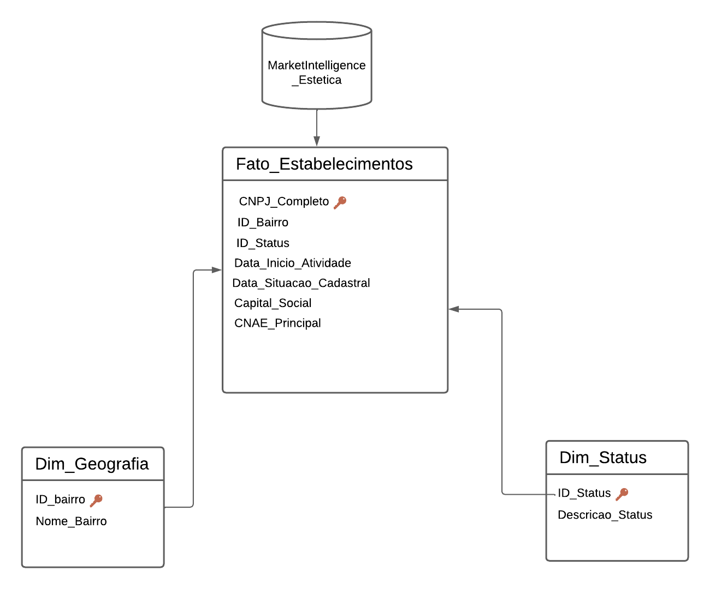
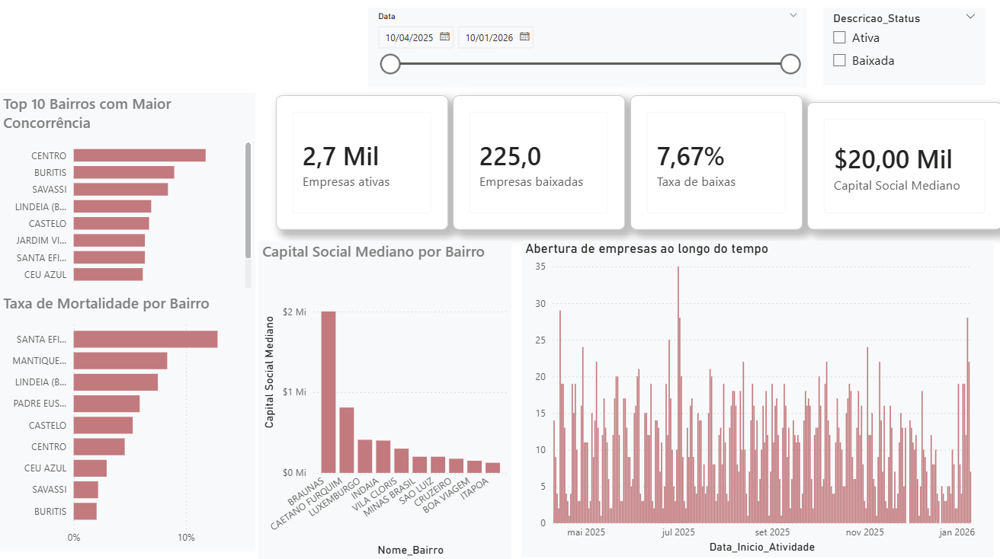

# 📊 Inteligência de Mercado: Expansão do Setor de Estética em Belo Horizonte


## 📌 O Problema de Negócio
O mercado de saúde, estética e cuidados pessoais tem apresentado forte crescimento. Este projeto tem como objetivo analisar a viabilidade e identificar as melhores regiões em Belo Horizonte e região metropolitana para a abertura de novos estabelecimentos do setor. 

A análise cruza dados demográficos com o histórico de abertura e fechamento de empresas (CNPJs) para responder:
- Qual a taxa de sobrevivência das clínicas de estética na região?
- Quais bairros possuem a maior defasagem de serviços em relação à sua população?
- Como o mercado se comportou após no ano de 2025 e 2026?

## 🏗️ Arquitetura da Solução
1. **Extração na Nuvem:** Consultas SQL no Google BigQuery utilizando o datalake público da *Base dos Dados*.
2. **Modelagem:** Armazenamento e estruturação em Star Schema (Fato e Dimensão) utilizando Microsoft SQL Server.
3. **Visualização:** Dashboard interativo em Power BI para exploração executiva.



**Detalhes da Modelagem:**
- **Fato_Estabelecimentos:** Tabela central contendo as métricas de negócio, datas de abertura/fecho e capital social. A granularidade é a nível de CNPJ único (garantida via tratamento de dados).
- **Dim_Geografia:** Dimensão de contexto espacial (Bairros de Belo Horizonte).
- **Dim_Status:** Dimensão que categoriza a situação cadastral (Ativa, Baixada, etc.).

## 🗂️ Fontes e Dicionário de Dados
Os dados foram extraídos do projeto [Base dos Dados](https://basedosdados.org/):
- `br_me_cnpj.empresas` e `br_me_cnpj.estabelecimentos`: Filtrado pelos CNAEs de estética (ex: 9602-5/02).
- `br_ibge_populacao.municipio`: Dados demográficos de Minas Gerais.

## 🚀 Como Executar este Projeto
1. Clone este repositório: `git clone https://github.com/KelvinAlbert/bh-clinicas-de-estetica.git`
2. Os scripts de extração do BigQuery estão na pasta `/scripts_sql`.
3. Para visualizar o resultado final e a interface do dashboard, confira as capturas de tela na pasta `/images` ou acesse a versão exportada em PDF na pasta `/dashboard`.



## 💡 Principais Insights Analíticos

Com base na visualização dos dados, extraímos conclusões valiosas para a tomada de decisão no mercado de estética em Belo Horizonte:

1. **Concentração da Concorrência:** O mercado está fortemente adensado na região do **Centro** e no bairro **Buritis**, que lideram o ranking de clínicas ativas. Investir nestas regiões requer estratégias de diferenciação mais agressivas devido à elevada oferta.
2. **Mapa de Risco (Mortalidade):** A taxa global de fecho de empresas do setor está estabilizada nos **7,67%**. No entanto, a análise geográfica revelou que bairros como **Santa Efigênia** apresentam uma taxa de mortalidade significativamente superior aos restantes, sinalizando um alerta de risco para novos empreendimentos nessa zona.
3. **Discrepância de Investimento:** O capital social mediano para a abertura de um espaço na cidade ronda os **R$ 20.000,00**. Curiosamente, os bairros com maior concorrência não são os que concentram os maiores investimentos. Regiões como **Braúnas** destacam-se por apresentar um capital mediano atípico (próximo dos R$ 2 Milhões), sugerindo a presença de clínicas de alto padrão ou redes empresariais estruturadas, e não apenas pequenos salões de bairro.

## 🧹 Qualidade de Dados e Tratamento de Anomalias (Outliers)

Durante a fase de análise exploratória no Power BI, o gráfico de capital social por bairro apresentou uma distorção severa, puxando a média do bairro União para mais de R$ 1,33 Bilhão. 

Ao realizar o *drill-down* e investigar a base diretamente no **SQL Server**, isolei o registro (CNPJ final 0640-80) e identifiquei um capital declarado de R$ 15.9 Bilhões. Para proteger a análise e garantir que o dashboard reflita exclusivamente a realidade do mercado local (micro e pequenas clínicas de estética), a métrica financeira principal foi alterada de Média para **Mediana**. Como a mediana é resistente a valores extremos, o *insight* financeiro permaneceu íntegro e condizente com o mercado.

**Medida DAX implementada:**
```dax
Capital Social Mediano = 
CALCULATE(
    MEDIAN('Fato_Estabelecimentos'[Capital_Social]),
    'Dim_Status'[Descricao_Status] = "Ativa"
)
```
## 👨‍💻 Autor
**[Kelvin Albert Boanerges Gonçalves Rosa]**
- [[LinkedIn](https://www.linkedin.com/in/kelvin-rosa-670a8a19b/)]
- [[GitHub](https://github.com/KelvinAlbert)]